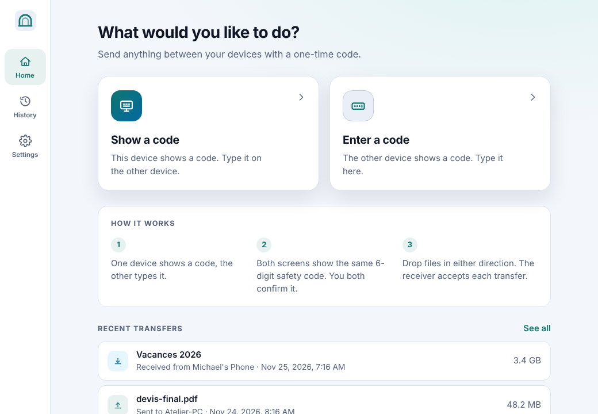
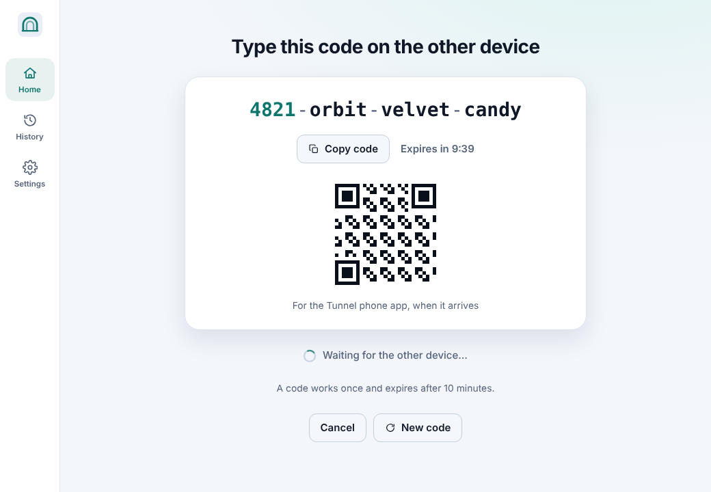
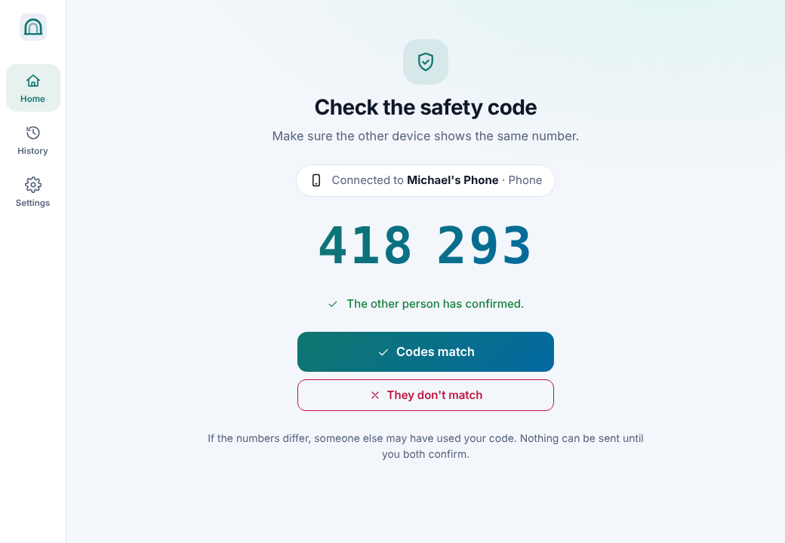
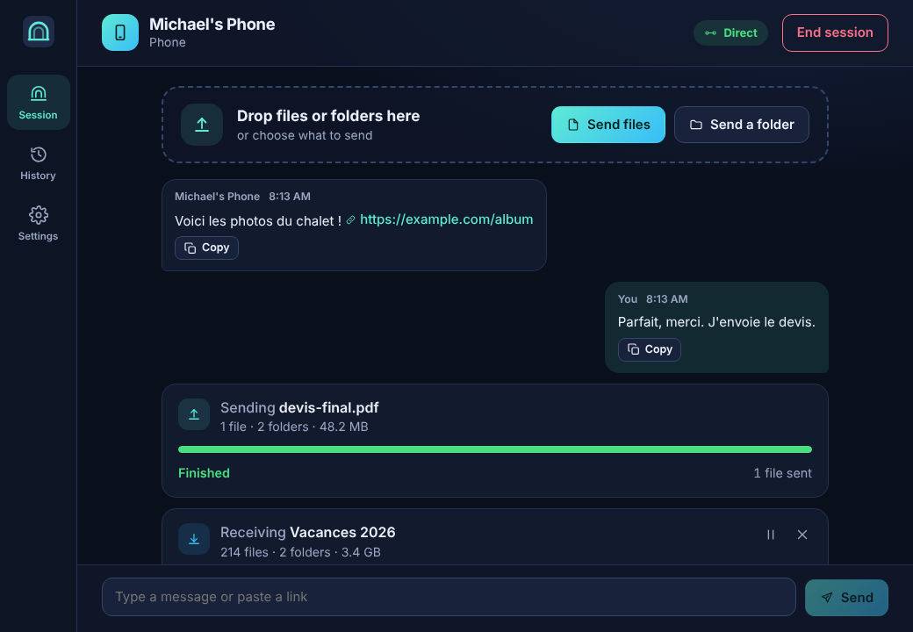

# Normandin Tunnel

Send files, folders and messages from one computer to another with a one-time
code. No account, no upload to a cloud, nothing stored on a server.

[](https://github.com/NormandinSystems/normandin-tunnel/actions/workflows/ci.yml)

**Free and open source. Preview release 0.1.0 for Windows and Linux.** It works, it is tested,
and it has not yet been reviewed by outside security experts. Please read
[what to know before you rely on it](#what-to-know-before-you-rely-on-it).

| | |
|---|---|
|  |  |
|  |  |

## What it does

* **Pairs two devices with a short code.** One device shows a code such as
  `4821-orbit-velvet-candle`. The other types it. Every code is new, works
  once, and expires after 10 minutes.
* **Encrypts everything between the two devices.** The devices connect
  directly when their networks allow it. When they cannot, the data passes
  through a relay that only ever sees scrambled packets.
* **Sends anything, either way.** Files, whole folders, and text. The
  receiving person sees what is offered and must accept it first.
* **Checks every file.** Each file is verified against a fingerprint of the
  original before it appears in your folder.
* **Keeps to itself.** No accounts, no analytics, no crash reports. History
  and settings stay on your device.
* **English and French**, light and dark themes.

## Get it

1. Open the [Releases page](https://github.com/NormandinSystems/normandin-tunnel/releases)
   and download the file for your system:

   | System | File to download |
   |---|---|
   | Windows 10 or 11 | the one ending in `-setup.exe` |
   | Debian, Ubuntu, Mint | the one ending in `.deb` |
   | Fedora, openSUSE | the one ending in `.rpm` |
   | Other Linux | the one ending in `.AppImage` |

2. Install it on **both** devices.

Windows will show a blue "Windows protected your PC" box, because the
installers are not code-signed yet. Choose **More info**, then **Run anyway**.
The [user guide](docs/USER_GUIDE.md#install) has the details for each system.

No release listed yet? You can [build it yourself](docs/DEVELOPMENT.md).

## Use it

1. On one device choose **Show a code**. On the other choose **Enter a code**
   and type what the first one shows.
2. Both screens now show the same 6-digit **safety code**. Compare them and
   choose **Codes match** on both devices. Nothing can be sent before that.
3. Drop files or folders onto the window, or type a message. The other person
   chooses **Accept**, and the files arrive in their `Downloads/Tunnel` folder.

Either side can send. The full walk-through is in the
[user guide](docs/USER_GUIDE.md).

## Is it safe?

In short:

* The three words of the code never leave your devices. They are checked with
  a method (SPAKE2) that gives anyone else exactly one guess in about
  2.2 billion. A wrong guess kills the code.
* The safety code on both screens is how you know nobody got in between.
* What travels is encrypted from one device to the other. Relays and anyone
  watching the network see scrambled data.
* Names sent by the other device are treated as untrusted: nothing can be
  saved outside the folder you chose, and nothing received is ever opened or
  run for you.

[How it works](docs/HOW_IT_WORKS.md) explains this in plain language, including
who can see what. The exact design is in [the protocol](docs/PROTOCOL.md) and
the [threat model](docs/THREAT_MODEL.md).

## What to know before you rely on it

This is a preview. We would rather tell you its limits than have you find them.

* **No outside security review yet.** The design is documented and tested,
  including against a deliberately hostile peer, but nobody independent has
  audited it. Do not use it for secrets where a mistake would be serious.
* **Both devices need internet access, even on the same Wi-Fi.** They meet
  through relays run by the [iroh](https://iroh.computer) project, which are
  free, shared and rate-limited, and come with no uptime promise. If they are
  unreachable, no code can be made. You can
  [run your own](docs/SELF_HOSTING.md) instead.
* **The installers are not code-signed.** Windows warns before running them.
* **Windows and Linux only.** There is no macOS, Android or iOS app yet.
* **No automatic updates.** Check the Releases page now and then.
* **It has been tested by machines far more than by people.** So far it has
  been used for real by its author only. See
  [what has been checked](docs/PROGRESS.md#how-it-was-checked).

## Documentation

| If you want to… | Read |
|---|---|
| Install and use the app | [User guide](docs/USER_GUIDE.md) |
| Understand what happens to your files | [How it works](docs/HOW_IT_WORKS.md) |
| Get a quick answer | [Questions and answers](docs/FAQ.md) |
| Run your own relay or pairing server | [Hosting your own servers](docs/SELF_HOSTING.md) |
| Build, test or change the code | [Development](docs/DEVELOPMENT.md) |
| Review the security | [Protocol](docs/PROTOCOL.md), [Threat model](docs/THREAT_MODEL.md) |
| See what is done and what is not | [Status](docs/PROGRESS.md), [Changelog](CHANGELOG.md) |
| Report a security problem | [Security policy](SECURITY.md) |

Everything is listed in the [documentation index](docs/README.md).

## Command line

The same engine is available as a command, `tunnel`, for Windows and Linux:

```sh
tunnel send ./photos report.pdf       # shows a code, waits, then sends
tunnel receive 4821-orbit-velvet-candle --to ~/Downloads
tunnel send --text "meet at 5"
```

It works with the desktop app on the other side. See the
[user guide](docs/USER_GUIDE.md#command-line).

## Contributing

Bug reports, questions and pull requests are welcome. Start with
[CONTRIBUTING.md](CONTRIBUTING.md). For anything security-related, use the
[security policy](SECURITY.md) instead of a public issue.

## Support the project

Normandin Tunnel is free and will stay free. If it is useful to you and you
would like to support its development with a donation, write to
[michael@normandinsystems.com](mailto:michael@normandinsystems.com).

## Credits

* Connections: [iroh](https://iroh.computer).
* App shell: [Tauri](https://tauri.app).
* Code words: EFF Short Wordlist #2, © Electronic Frontier Foundation,
  CC BY 3.0 US.
* The idea of pairing two computers with a short spoken code comes from
  [Magic Wormhole](https://github.com/magic-wormhole/magic-wormhole).

## Licence

Copyright © 2026 Normandin Systems.

Licensed under either of

* the Apache License, Version 2.0 ([LICENSE-APACHE](LICENSE-APACHE)), or
* the MIT license ([LICENSE-MIT](LICENSE-MIT)),

at your option. You may use, change and share this software, including in
your own products, under the terms of whichever of the two you choose.

Unless you explicitly state otherwise, any contribution you intentionally
submit for inclusion in this project, as defined in the Apache-2.0 licence,
is dual-licensed as above, without any additional terms or conditions.
