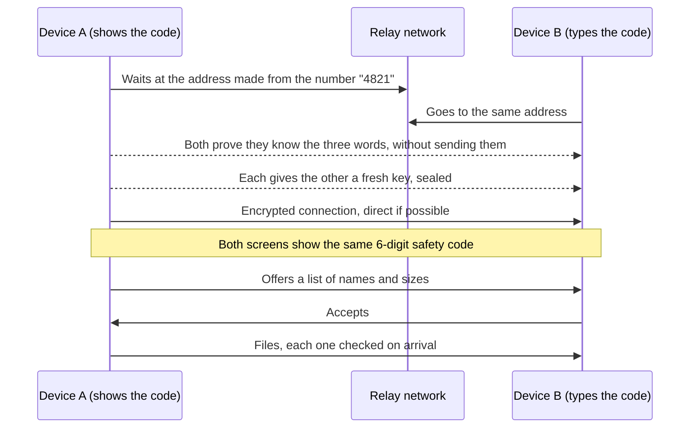

# How it works

A plain-language explanation of what happens when you use Normandin Tunnel,
who can see what, and where the limits are. For the exact bytes and formulas,
see [PROTOCOL.md](PROTOCOL.md).

## The short version

Two devices agree on a secret using a short code that only the two people
know. With that secret they open an encrypted connection to each other,
directly when they can. Files then travel over that connection and are checked
on arrival.

## Step by step

### 1. Finding each other

A code looks like `4821-orbit-velvet-candle`. It has two parts with two
different jobs.

* **The number** is an address. The device showing the code waits on the relay
  network at a meeting point worked out from that number. The device typing
  the code works out the same meeting point and goes there. The number is not
  secret.
* **The three words** are the secret. They never leave either device, and they
  are not part of the address.

The meeting point exists only while the code is on screen.

### 2. Proving the code matches

The two devices run a password check called SPAKE2. Each proves to the other
that it knows the same three words, without ever sending them. Someone
listening learns nothing about the words.

Someone who knows only the number can turn up at the meeting point and try a
guess. They get exactly one. There are about 2.2 billion possible word
combinations, and a wrong answer ends the code for everyone. You would see the
connection fail and make a new code.

### 3. Connecting

Once the check passes, each device hands the other a brand-new key made for
this session only, along with its network addresses, sealed so that nobody
else can read them. The devices then open an encrypted connection tied to
those keys.

They try to connect straight to each other first. That works on most home
networks and whenever both devices are on the same network. When a router or
firewall makes it impossible, the encrypted data goes through a relay instead.
The window tells you which: **Direct** or **Through relay**.

### 4. The safety code

Both screens show the same 6-digit number, calculated from the keys the two
devices ended up with. If someone had managed to get in between, the two
numbers would differ. Nothing can be sent until both people confirm that the
numbers match.

### 5. Sending files

1. The sender offers a list: names and sizes, nothing else yet.
2. The receiver sees it, with warnings if something looks risky, and accepts
   or declines.
3. The receiver's device then asks for each file. Several files travel at
   once, each on its own channel inside the encrypted connection.
4. Each file is written into a hidden temporary folder. When it is complete,
   it is compared with a fingerprint of the original (BLAKE3). Only a file
   that matches is moved into your save folder.
5. If the connection drops, the devices reconnect for up to two minutes and
   continue from where they stopped.

Names coming from the other device are treated as untrusted. A file can never
be saved outside the folder you chose, whatever its name claims, and names
that are unsafe on your system are changed. Nothing received is ever opened or
run by the app.

## Who can see what

| Who | Can see | Cannot see |
|---|---|---|
| Someone on your Wi-Fi, or your internet provider | That your device is talking to another device or to a relay, roughly how much data, and when | File names, contents, messages, the code words |
| The relay | Both devices' IP addresses, which four-digit number is in use, and the amount and timing of any data it carries | The code words, the keys, file names, contents, messages |
| Normandin Systems | Nothing. We run no servers that the app talks to | |
| The other person | The device name you chose, your IP address, and whatever you send them | Anything else on your computer |

Nothing is stored on any server. A relay passes packets along and keeps no
files.

## What this does not protect against

* **A compromised computer.** If one of the two devices has malware, it can
  read the files there. No transfer tool can fix that.
* **Sending to the wrong person.** If you give your code to a stranger and
  confirm the safety code with them, they are connected to you. They still
  cannot take anything: you choose what to send and what to accept.
* **Risky files.** The app warns about programs and scripts, but a file is
  only as trustworthy as its sender.
* **A stranger spoiling a code.** Someone who knows the four-digit number
  while your code is on screen can waste it with a wrong guess. They gain
  nothing, and you make a new code.
* **Mistakes we have not found.** No outside security review has been done
  yet. See the [threat model](THREAT_MODEL.md) for what was considered and
  what is known to be missing.

## The relays

By default the app uses public relays run by the [iroh](https://iroh.computer)
project. They are free and shared. Their operators describe them as meant for
development, testing and hobby projects: traffic through them is rate-limited
and they come with no uptime promise.

That is fine for trying the app and for occasional use. If you want to depend
on nobody else, or you need it to work on a network with no internet access,
you can run your own relay or pairing server and point the app at it. See
[Hosting your own servers](SELF_HOSTING.md).
